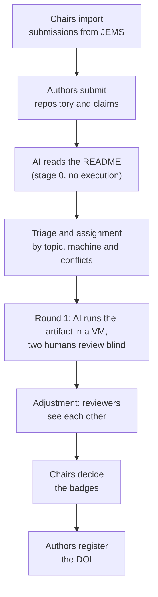

  

  <b>Software for evaluating research artifacts at the SBSeg Artifact Committee (CTA).</b> 
  Built at the Universidade Federal do Pampa (UNIPAMPA), Brazil.

## What we are building

`cta-artefatos` is the web system for the Artifact Committee of SBSeg, the Brazilian Symposium on Information and Computer System Security. It follows each artifact of the Salão de Ferramentas (the tools track) from the moment the chairs import the accepted submissions from JEMS until the authors register the DOI of the evaluated version.

An AI agent reads every README and runs the artifact in a clean virtual machine before two human reviewers look at it. The humans review blind to the AI and to each other in the first round; afterwards each reviewer sees the other evaluations, and the chairs decide the badges.

| | |
|---|---|
| Status | v0: the full cycle with demonstration data, while the process is discussed for SBSeg 2027 |
| Interface | Portuguese, English and Spanish, checked against WCAG 2.1 AA |
| Stack | Next.js 16, React 19, Drizzle with PostgreSQL, Zod, next-intl |
| Repository | [`cta-artefatos`](https://github.com/bagualCTA/cta-artefatos) (private for now) |

## Where it comes from

The system started in the Software Artifact Engineering Laboratory course (AL5171, LEAS) of the graduate program in software engineering (PPGES) at UNIPAMPA, Alegrete campus, taught by Prof. Diego Kreutz.

A *bagual* is an untamed horse of the Pampa, the grasslands of southern Brazil. The rosette around it is a committee badge, and the orange ribbons are the color the system uses for the AI.

## People

<table>
<tr>
<td width="140" valign="top" align="center">

</td>
<td valign="top">
<b>DIEGO KREUTZ</b> is a professor and researcher at AI Horizon Labs, Universidade Federal do Pampa (UNIPAMPA), where he has taught since 2008 and coordinates the group. He received the B.S. degree in computer science and the M.Sc. degrees in production engineering and in informatics from the Universidade Federal de Santa Maria (UFSM), and the Ph.D. degree in computing, and has carried out research at the University of Lisbon, the University of Luxembourg and Monash University. His interests include cybersecurity and adversarial AI, language models, AutoML, distributed systems and networks, and software artifact engineering.
  
<a href="https://orcid.org/0000-0003-0830-0238">ORCID</a> ·
<a href="http://lattes.cnpq.br/2781747995973774">Lattes</a> ·
<a href="https://scholar.google.com/citations?user=JcL8biEAAAAJ">Scholar</a> ·
<a href="https://github.com/diegokreutz">GitHub</a> ·
<a href="https://www.linkedin.com/in/diegokreutz/">LinkedIn</a>
</td>
</tr>
<tr>
<td width="140" valign="top" align="center">

</td>
<td valign="top">
<b>CRISTHIAN KAPELINSKI</b> works on security, privacy, and machine learning at AI Horizon Labs, Universidade Federal do Pampa (UNIPAMPA). He has held research fellowships with the Brazilian National Research and Education Network (RNP), where he led the AnonShield and AnonLFI pseudonymization frameworks, with the Instituto Tecnológico de Aeronáutica (ITA), and with the LARC laboratory of the University of São Paulo (USP). His interests include privacy and memorization in language models, their use in security operations and the attacks against them, and large-scale measurement of software ecosystems.
  
<a href="https://orcid.org/0009-0005-5750-022X">ORCID</a> ·
<a href="http://lattes.cnpq.br/0100277568164430">Lattes</a> ·
<a href="https://scholar.google.com/citations?user=lV1lq-0AAAAJ">Scholar</a> ·
<a href="https://github.com/CristhianKapelinski">GitHub</a> ·
<a href="https://www.linkedin.com/in/cristhiankapelinski">LinkedIn</a>
</td>
</tr>
<tr>
<td width="140" valign="top" align="center">

</td>
<td valign="top">
<b>BEATRIZ MACHADO</b> works on cybersecurity research at AI Horizon Labs, Universidade Federal do Pampa (UNIPAMPA), on vulnerability analysis, data anonymization, and the use of language models to automate security work. She was a research fellow with the Brazilian National Research and Education Network (RNP), and wrote MulitaMiner, which turns the heterogeneous reports of security scanners into structured records with the help of language models. That work received second place for best paper at WRSeg 2025.
  
<a href="https://orcid.org/0009-0002-2750-0323">ORCID</a> ·
<a href="http://lattes.cnpq.br/6591374203213574">Lattes</a> ·
<a href="https://github.com/inari18">GitHub</a> ·
<a href="https://www.linkedin.com/in/beatriz18/">LinkedIn</a>
</td>
</tr>
</table>

Lattes is the Brazilian national registry of researcher CVs, maintained by CNPq, the federal
research council.
