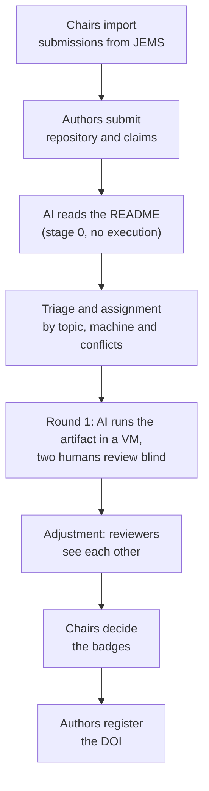

  

  <b>Software for evaluating research artifacts at the SBSeg Artifact Committee (CTA).</b> 
  Built at the Universidade Federal do Pampa (UNIPAMPA), Brazil.

## What we are building

`cta-artefatos` is the web system for the Artifact Committee of SBSeg, the Brazilian Symposium on Information and Computer System Security. It follows each artifact of the Salão de Ferramentas (the tools track) from the moment the chairs import the accepted submissions from JEMS until the authors register the DOI of the evaluated version.

An AI agent reads every README and runs the artifact in a clean virtual machine before two human reviewers look at it. The humans review blind to the AI and to each other in the first round; afterwards each reviewer sees the other evaluations, and the chairs decide the badges.

| | |
|---|---|
| Status | v0: the full cycle with demonstration data, while the process is discussed for SBSeg 2027 |
| Interface | Portuguese, English and Spanish, checked against WCAG 2.1 AA |
| Stack | Next.js 16, React 19, Drizzle with PostgreSQL, Zod, next-intl |
| Repository | [`cta-artefatos`](https://github.com/bagualCTA/cta-artefatos) (private for now) |

## Where it comes from

The system started in the Software Artifact Engineering Laboratory course (AL5171, LEAS) of the graduate program in software engineering (PPGES) at UNIPAMPA, Alegrete campus, taught by Prof. Diego Kreutz.

A *bagual* is an untamed horse of the Pampa, the grasslands of southern Brazil. The rosette around it is a committee badge, and the orange ribbons are the color the system uses for the AI.
